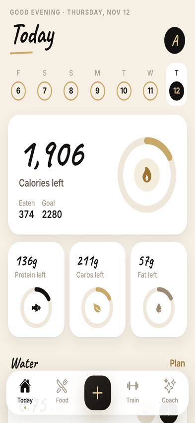
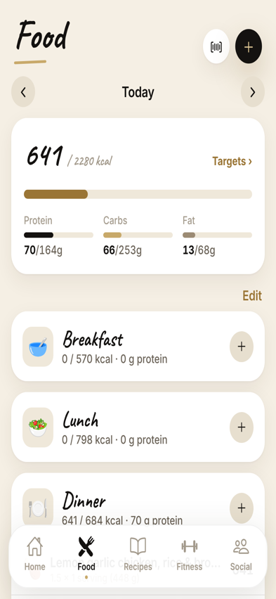
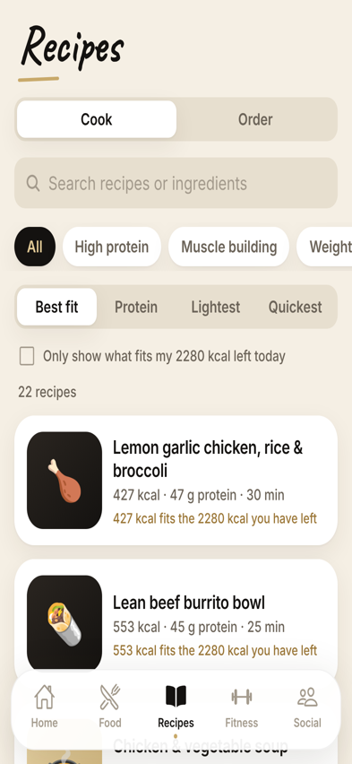
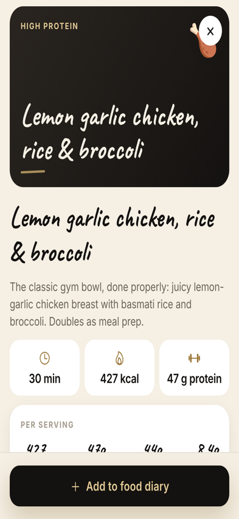
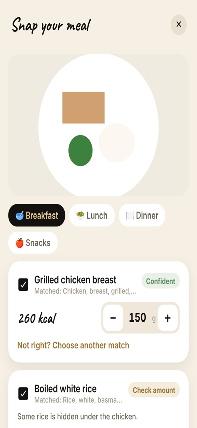
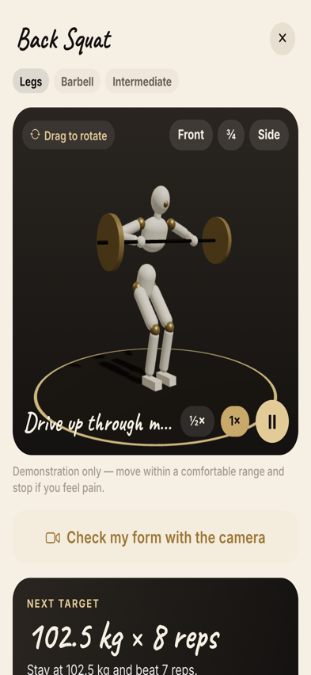

# Breeze — by M3XI

A fitness and wellness app for iOS and Android, built with **Expo (React Native + TypeScript)**. Sky colours (dawn peach, day blue, night navy) on cloud white, with handwritten notebook headings, Lucide line icons, anatomical muscle maps and a 3D trainer figure with visible muscles.

**Food-first:** understand your food → discover your meals → track your progress. Fitness and community support it.

| Home | Food | Recipes | Recipe | Snap your meal | 3D trainer |
|---|---|---|---|---|---|
|  |  |  |  |  |  |

Navigation: **Home · Food · Recipes · Fitness · Social**

## Features

| Area | What it does |
|---|---|
| **Home** | Calories remaining with protein/carbs/fat, one-tap logging (search, barcode, photo, saved), meals that fit your remaining calories and protein, eat-it-again, then fitness and community |
| **Food diary** | Meals by category (add your own categories), every entry editable, copy yesterday, save any meal for reuse, water |
| **Targets** | Calculated from your details (Mifflin–St Jeor), assumptions shown in plain English, every target editable |
| **Food logging** | 2,854 UK foods (CoFID 2021, OGL) by grams, UK branded products and barcodes (Open Food Facts), favourites, saved and custom meals, manual entry, AI photo recognition |
| **Recipes** | 22 launch recipes built from CoFID ingredients: nutrition per serving, allergens and diet labels are calculated, not typed. Need-based filters, best-fit ranking with reasons, servings scaling, method with timers, **Add to food diary**. *What this meal gives you*: share of your daily targets, FSA traffic lights, fibre, and UK-authorised nutrition and health claims only where the conditions are met |
| **Meal plan** | Plan recipes for the week and get a shopping list grouped by supermarket section |
| **Ready meals** | *Coming soon* — no provider listings until agreements exist |
| **Fitness** | Anatomical muscle map for every exercise (main and supporting muscles), 3D trainer figure whose worked muscles glow (5 skin tones), 36 exercises, camera form check (on-device), sets/reps/progression, rest timer, AI trainer |
| **Social** | Gym buddies (18+, safety guidelines, block/report; sample profiles until accounts launch); community features listed as coming soon |

One nutrition engine (`src/lib/nutrition.ts`) does every calculation, so meal, day and recipe totals always agree. Entries store exact values and round only for display.

Demo data: development builds start with two weeks of flagged sample history; release builds start empty. Remove or load it in Profile → Demo data.

Safety, privacy and age policy: [`docs/SAFETY_AND_PRIVACY.md`](docs/SAFETY_AND_PRIVACY.md) · Data licences: in-app under Profile → Data sources & licences · Plan: [`docs/FOOD_FIRST_PROPOSAL.md`](docs/FOOD_FIRST_PROPOSAL.md).

## Run it in an emulator

```bash
git clone https://github.com/M3XI-Company/FitnessApp && cd FitnessApp
npm install
npx expo start
```

Press `a` for an Android emulator (Android Studio) or `i` for the iOS Simulator (Xcode on a Mac), or scan the QR code with **Expo Go** on a phone. Everything uses modules included in Expo Go.

Testing notes:
- **iOS Simulator has no camera.** Barcode scanning and the camera form check need a real iPhone (or an Android emulator with a virtual camera). Use "Choose from photos" and the scanner's sample products in the simulator.
- **Camera form check** downloads the MediaPipe pose model (~6 MB) the first time; it needs an internet connection.
- **Snap your meal** needs the server set up once — see [`docs/FOOD_PHOTO.md`](docs/FOOD_PHOTO.md). Until then the screen explains it isn't connected.

## Checks

```bash
npx tsc --noEmit
npx expo lint
npm test            # 30 tests: nutrition engine, recipes, form feedback
```

## Project structure

```
src/app/                 screens (Expo Router)
  (tabs)/                Home · Food · Recipes · Fitness · Social
  recipe/[id].tsx        recipe page with Add to diary
  targets.tsx, meal-builder.tsx
  exercise/[id].tsx      3D trainer, set logging, rest timer
  form-check/[id].tsx    camera form check (consent → setup → live → review)
  scanner.tsx            barcode / product scanner
  food-photo.tsx         Snap your meal
  add-food.tsx, edit-food.tsx, plans.tsx, profile.tsx, licences.tsx, onboarding.tsx …
src/components/trainer/  3D mannequin, movement library, React Three Fiber view
src/components/form/     camera + pose runner (WebView on device, iframe on web)
src/lib/form/            form-feedback engine (pure TypeScript, unit-tested)
src/lib/                 store, nutrition engine, recipes engine, UK food search, products, age policy, licences
src/data/recipes.ts      launch recipes (ingredients reference CoFID foods)
src/data/cofid.json      UK CoFID 2021 (generated by scripts/import_cofid.py)
supabase/                food-photo Edge Function + ai_usage migration
scripts/                 CoFID importer, MediaPipe asset setup
docs/                    safety & privacy, food photo, spec review, brief, Yazio case study
```

## Licences

- UK food data: Contains public sector information licensed under the Open Government Licence v3.0 (CoFID 2021, OHID/PHE).
- Product data: Open Food Facts contributors, Open Database Licence; images CC BY-SA.
- Pose model and runtime: Google MediaPipe, Apache 2.0.
