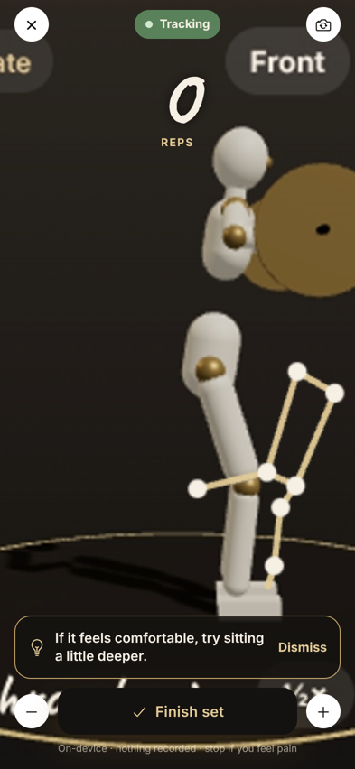

# Breeze — by M3XI

A fitness and wellness app for iOS and Android, built with **Expo (React Native + TypeScript)**. Cream, white, black and champagne gold, with handwritten notebook headings.

| Today | Food | 3D trainer | Camera form check | Snap your meal | Gym buddies (18+) |
|---|---|---|---|---|---|
|  |  |  |  |  |  |

## Features

| Area | What it does |
|---|---|
| **Onboarding** | Builds a daily calorie, macro and water plan; minimum age 16; health & safety notice must be accepted |
| **Food tracking** | Diary by meal, calories-left hero, macro rings, every entry editable |
| **UK nutrition data** | 2,854 generic foods from the UK government's CoFID 2021 dataset (Open Government Licence), logged by grams; salt shown as salt; kJ and kcal |
| **Barcode & product scanner** | Live UK lookups on Open Food Facts (ODbL), warning when a product isn't listed as sold in the UK, FSA traffic lights, A–E grade, fit to your day |
| **Snap your meal** | Photo → Claude vision identifies foods and estimates grams on Breeze's server → nutrition from CoFID → you confirm before logging |
| **3D trainer** | Original 3D mannequin demonstrates all 36 exercises; drag to rotate, front/¾/side, half speed, phase cues |
| **Camera form check** | On-device pose tracking counts reps and gives cautious, dismissible form cues; nothing recorded |
| **Reps & progression** | Set logging, next-session targets, PRs, estimated 1-rep-max trends, rest timer |
| **Goals & progression** | XP and levels (Whisper → Hurricane), streaks, goals, achievements |
| **Plans** | Boxed meals for the week, shopping list by aisle, water schedule |
| **AI trainer** | Chat coach that builds workouts and gives advice from your own logs (rule-based, on-device) |
| **Gym buddies (18+)** | Meeting-safety guidelines, approximate distance only, block and report; no adult–minor matching |

Safety, privacy and age policy: [`docs/SAFETY_AND_PRIVACY.md`](docs/SAFETY_AND_PRIVACY.md) · Data licences: in-app under Profile → Data sources & licences.

## Run it in an emulator

```bash
git clone https://github.com/M3XI-Company/FitnessApp && cd FitnessApp
npm install
npx expo start
```

Press `a` for an Android emulator (Android Studio) or `i` for the iOS Simulator (Xcode on a Mac), or scan the QR code with **Expo Go** on a phone. Everything uses modules included in Expo Go.

Testing notes:
- **iOS Simulator has no camera.** Barcode scanning and the camera form check need a real iPhone (or an Android emulator with a virtual camera). Use "Choose from photos" and the scanner's sample products in the simulator.
- **Camera form check** downloads the MediaPipe pose model (~6 MB) the first time; it needs an internet connection.
- **Snap your meal** needs the server set up once — see [`docs/FOOD_PHOTO.md`](docs/FOOD_PHOTO.md). Until then the screen explains it isn't connected.

## Checks

```bash
npx tsc --noEmit
npx expo lint
npm test            # form-feedback engine unit tests
```

## Project structure

```
src/app/                 screens (Expo Router)
  (tabs)/                Today · Food · Train · Coach
  exercise/[id].tsx      3D trainer, set logging, rest timer
  form-check/[id].tsx    camera form check (consent → setup → live → review)
  scanner.tsx            barcode / product scanner
  food-photo.tsx         Snap your meal
  add-food.tsx, edit-food.tsx, plans.tsx, profile.tsx, licences.tsx, onboarding.tsx …
src/components/trainer/  3D mannequin, movement library, React Three Fiber view
src/components/form/     camera + pose runner (WebView on device, iframe on web)
src/lib/form/            form-feedback engine (pure TypeScript, unit-tested)
src/lib/                 store, nutrition maths, UK food search, products, age policy, licences
src/data/cofid.json      UK CoFID 2021 (generated by scripts/import_cofid.py)
supabase/                food-photo Edge Function + ai_usage migration
scripts/                 CoFID importer, MediaPipe asset setup
docs/                    safety & privacy, food photo, spec review, brief, Yazio case study
```

## Licences

- UK food data: Contains public sector information licensed under the Open Government Licence v3.0 (CoFID 2021, OHID/PHE).
- Product data: Open Food Facts contributors, Open Database Licence; images CC BY-SA.
- Pose model and runtime: Google MediaPipe, Apache 2.0.
