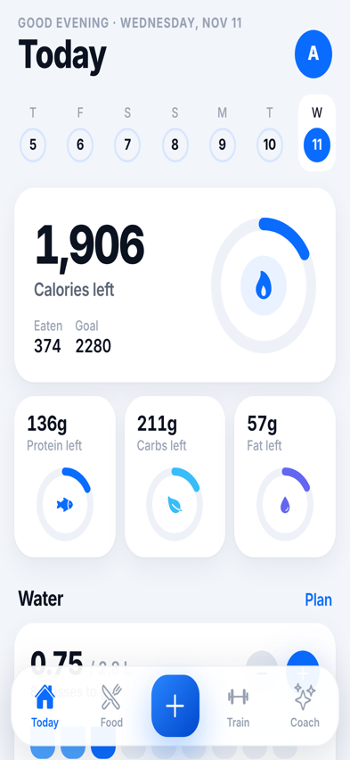
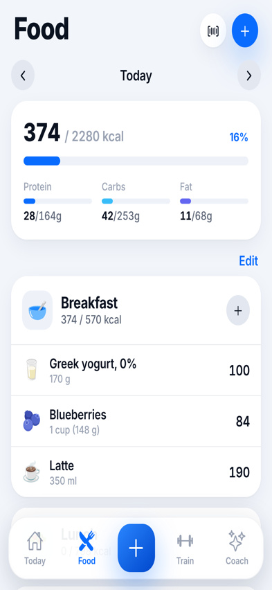
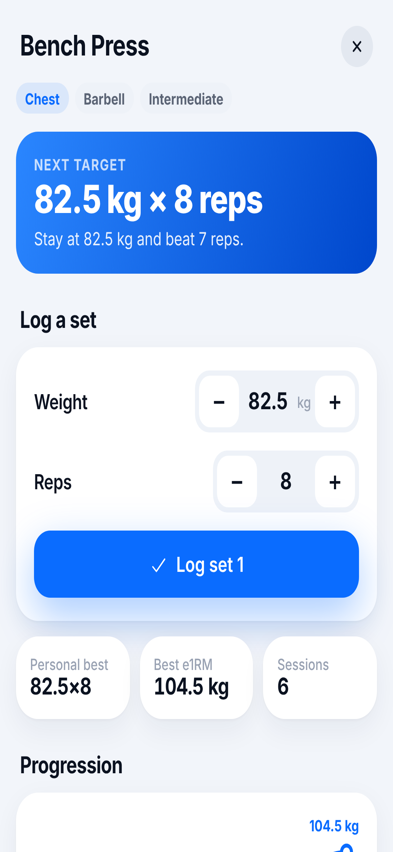
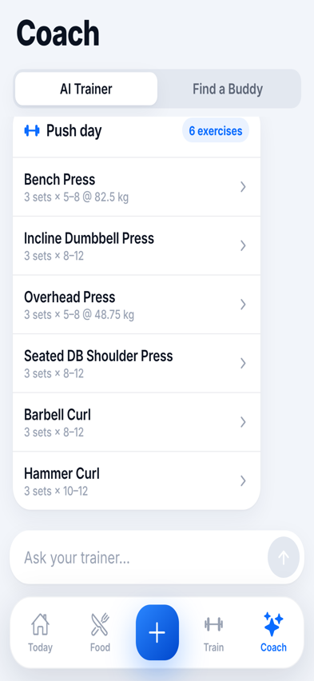
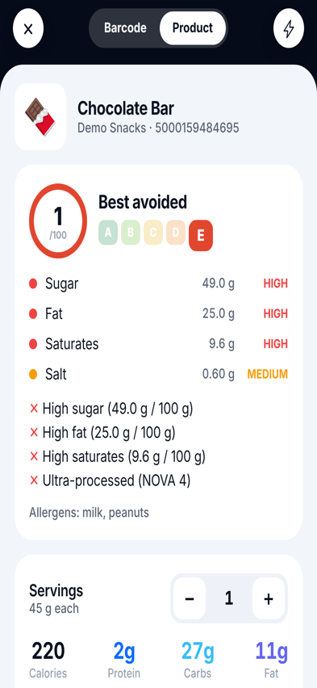
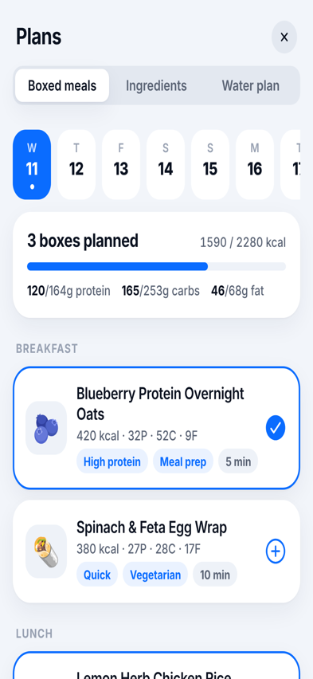

# Tide — Fitness & Nutrition

A native iOS / Android fitness app built with **Expo (React Native + TypeScript)**. Blue theme, with a clean, high-contrast look inspired by Cal AI and Apple's design language: large titles, grouped cards, rings, floating tab bar, native sheets and haptics.

| Today | Food | Exercise | AI Trainer | Product scanner | Boxed meals |
|---|---|---|---|---|---|
|  |  |  |  |  |  |

## Features

| Area | What it does | Where |
|---|---|---|
| **Onboarding** | Builds a daily plan from your sex, age, height, weight, activity level and goal (Mifflin–St Jeor + activity factor). Sets calories, macros and water. | `src/app/onboarding.tsx` |
| **Calorie tracker** | Big "calories left" hero, protein/carb/fat rings, a 7-day strip | `src/app/(tabs)/index.tsx` |
| **Food tracker** | Diary by meal, day-by-day navigation, edit/delete, food search, recent foods, manual entry | `src/app/(tabs)/food.tsx`, `src/app/add-food.tsx` |
| **Barcode scanner** | Native camera scanning (EAN/UPC) → [Open Food Facts](https://world.openfoodfacts.org) lookup → log with a serving stepper | `src/app/scanner.tsx`, `src/lib/products.ts` |
| **Product scanner** | Health score (0–100), A–E grade, traffic lights for sugar, fat, saturated fat and salt, pros and cons, allergens, and how the item fits your remaining calories | same as above (`analyze()`) |
| **Exercise list** | 36 exercises, filterable by muscle group and equipment, with search | `src/app/(tabs)/train.tsx`, `src/data/exercises.ts` |
| **Reps & progression** | Set logger (weight × reps), double-progression "next target", PR detection, estimated 1-rep max (Epley) trend chart, session history, form cues | `src/app/exercise/[id].tsx`, `src/lib/progress.ts` |
| **Goal / progression system** | XP and levels (Ripple → Tsunami), streaks, custom goals with live progress, achievements | `src/app/profile.tsx`, `src/lib/progress.ts` |
| **Boxed meals** | Pre-built meal "boxes" with macros, tags, ingredients and steps. Plan them per day for the next 7 days, or log one with a tap | `src/app/plans.tsx`, `src/data/boxedMeals.ts` |
| **Ingredients plan** | Shopping list built from your planned boxes, combined across days, grouped by aisle, with checkboxes | `src/app/plans.tsx` |
| **Water tracker / plan** | Glass-based tracker, and a daily schedule (start, finish, glass size) with Done/Due states. Counts water from boxed meals too | `src/components/WaterCard.tsx`, `src/app/plans.tsx` |
| **AI Trainer** | Chat coach that reads your data: builds push/pull/legs/upper/lower/full/home workouts with weights from your history, gives form tips, checks your macros, reviews your progress, and covers recovery | `src/app/(tabs)/coach.tsx`, `src/lib/coach.ts` |
| **Filtered Buddy** | Find workout partners filtered by goal, level, time of day and distance, ranked by a match score against your profile | `src/app/(tabs)/coach.tsx`, `src/data/buddies.ts` |
| **Yazio case study** | Competitive analysis and how Tide differs | [`docs/YAZIO_CASE_STUDY.md`](docs/YAZIO_CASE_STUDY.md) |

## Run it

```bash
npm install
npx expo start
```

Then press `i` (iOS simulator), `a` (Android emulator), or scan the QR code with **Expo Go** on your phone. All native modules used here (camera, haptics, linear gradient, SVG, async storage) are included in Expo Go.

To build installable apps with EAS:

```bash
npx eas-cli@latest build --profile development --platform ios
```

Checks:

```bash
npx tsc --noEmit
npx expo lint
```

## Project structure

```
src/
  app/                 Expo Router screens
    (tabs)/            Today · Food · Train · Coach (custom floating tab bar)
    add-food.tsx       modal
    scanner.tsx        full-screen camera modal (barcode + product modes)
    plans.tsx          boxed meals · ingredients · water plan
    exercise/[id].tsx  set logger + progression
    profile.tsx        XP, goals, achievements, targets
    onboarding.tsx, quick-add.tsx, weight.tsx
  components/          design-system primitives (Card, Ring, Stepper, charts…)
  data/                exercises, foods, boxed meals, buddies
  lib/                 store (AsyncStorage), nutrition math, progression, coach engine, product lookup
  theme.ts             colors, typography, shadows
```

## Notes and next steps

- **Data** stays on the device (AsyncStorage). The app ships with two weeks of sample history so every screen has data on first launch. Use *Profile → Reset demo data* to restore it.
- **AI Trainer** runs a deterministic engine on the device (`src/lib/coach.ts`), so it works offline and needs no API key. To connect an LLM, replace `reply()` with a call to your backend. Keep the API key on the server, not in the app.
- **Barcode lookups** use the free Open Food Facts API. Four sample barcodes work offline (*Try a sample* in the scanner).
- **Buddies** are sample profiles. A real version needs a backend (auth, location, messaging, moderation).
